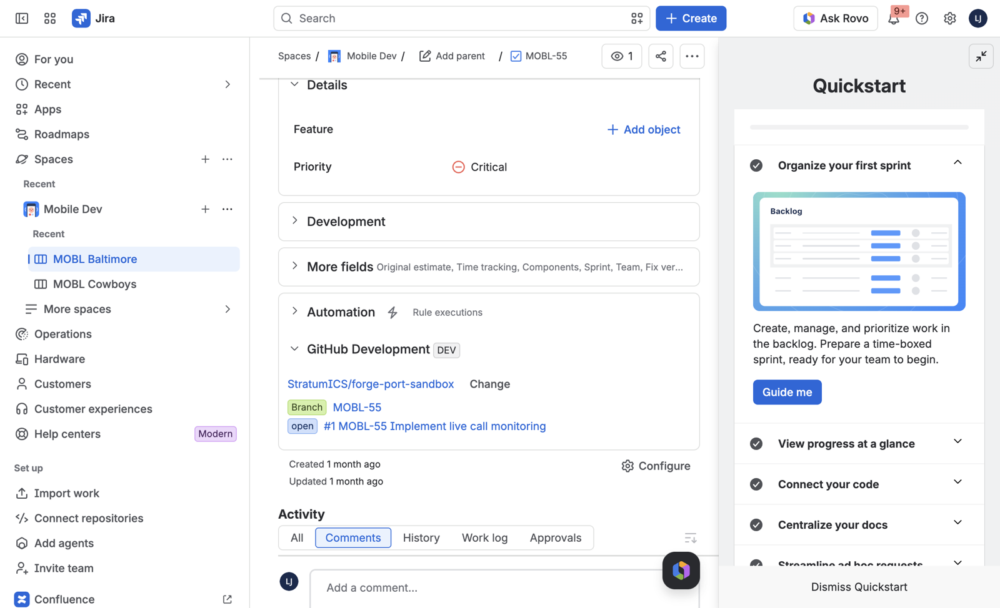
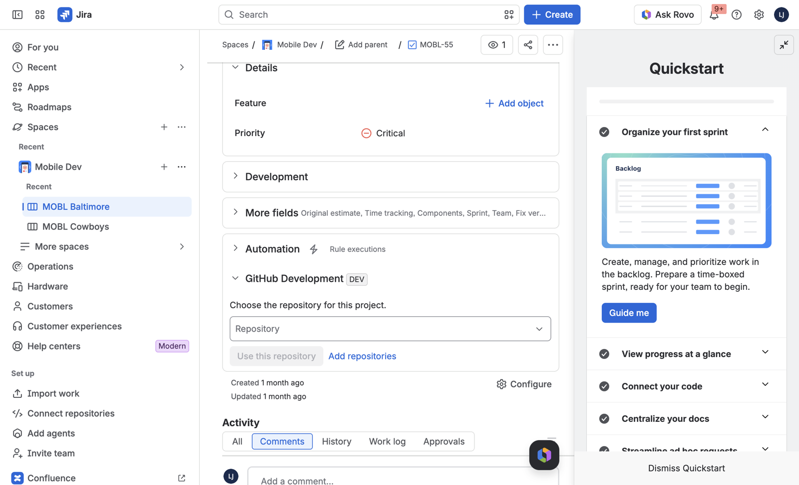
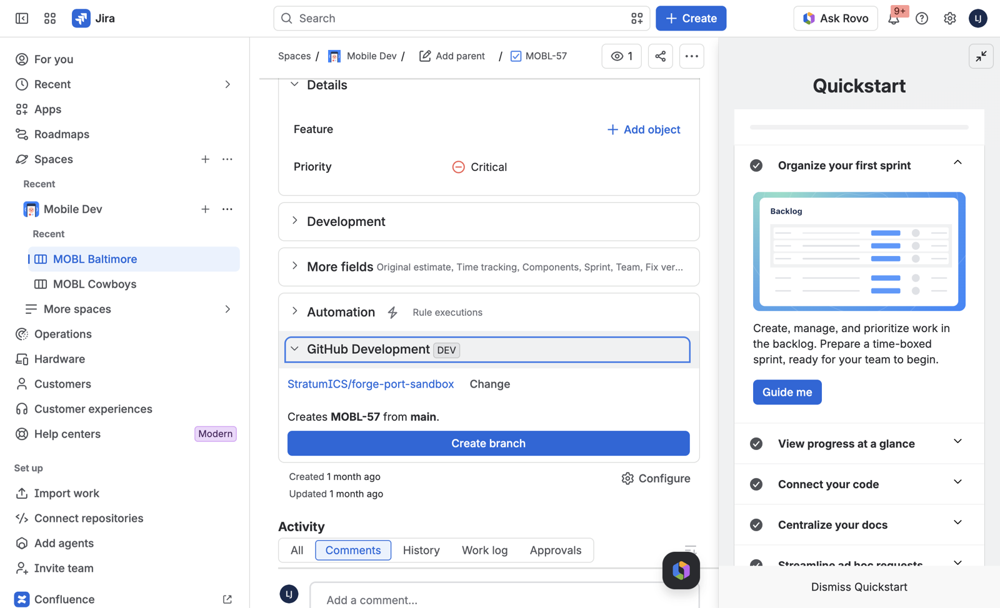
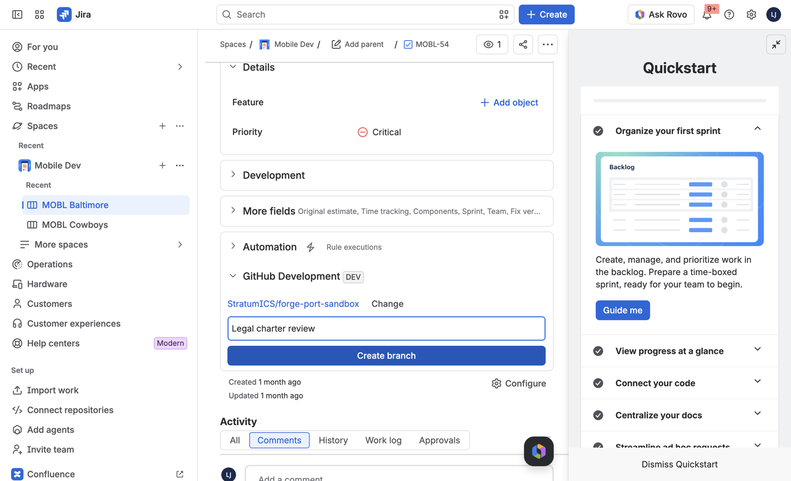

# A Connect app rebuilt on Forge: Create GitHub Branches from Jira

This repository is a worked example. It takes a real Atlassian Marketplace app that still runs on
Connect, [Create GitHub Branches from Jira](https://marketplace.atlassian.com/apps/1217260/create-github-branches-from-jira)
(494 installs on 14 November 2026), and rebuilds it on Forge from its
[public MIT source](https://github.com/osowskit/atlassian-github-app-addon).

The result is installed on a Jira Cloud site and was run against a GitHub repository. Pressing
**Create branch** in a Jira issue creates the branch on GitHub.

Stratum ICS is not affiliated with the app's vendor. The app, its listing and its name are theirs.
This port exists to show what a Connect to Forge migration involves. It is built from the public
source, which is older than the app the vendor runs today, so it is a method shown on real code
and not a finished cutover.



## Why this matters now

Atlassian ends support for Connect on 31 January 2027. After that date it fixes only critical
security problems, and says some platform changes "will cause apps to stop functioning without
advance notice".

Before then, the people using a Connect app are told. Atlassian's changelog of 13 November 2026
says a notice goes to production sites through December. For an app whose developer has declared
no plan, it reads: "[App name] might change or stop working because it is running on a platform
we'll no longer support after January 2027. The developer has not provided a migration plan."
The notice is not shown for an app that has adopted a Forge manifest and declared that it will
migrate.

Atlassian said in August 2026 that "Over 95% of paid app seats have been migrated to Forge". An
app that adopts Forge keeps its listing, its reviews and its installs.

Sources: [Getting ready for Connect end of support](https://www.atlassian.com/blog/development/getting-ready-for-connect-end-of-support),
[What users see in product](https://developer.atlassian.com/platform/adopting-forge-from-connect/what-users-see-in-product/),
[Forge changelog](https://developer.atlassian.com/platform/forge/changelog/).

## What changed

| In the Connect app | In the Forge app |
| --- | --- |
| `webPanels` entry `osowskit-app`, an iframe served from Heroku | `jira:issueContext` module with the same key, rendered with UI Kit |
| `postInstallPage` | `jira:adminPage` with `useAsGetStarted` |
| Sinatra server on Heroku (`server.rb`) | Forge functions (`src/resolvers`, `src/lib`) |
| Cookie session holding the user's GitHub token and chosen repository | GitHub token held by Forge external auth; the chosen repository in Forge storage |
| GitHub OAuth handshake coded by hand (`/callback`) | `providers.auth` in `manifest.yml`; Forge runs the handshake and refreshes the token |
| JWT authentication and `installed` / `uninstalled` lifecycle callbacks | Not needed. Forge authenticates every call |
| Jira scope `read` | No Jira scope. The issue key arrives in the module context |
| GitHub App private key in a Heroku config variable | Encrypted Forge variable |

Nothing is left to host. The Heroku app, its cookie secret and its Connect descriptor all go away.

## What stayed the same for the people using it

- The panel is where it was: **GitHub Development**, in the right-hand column of the issue.
- Connect GitHub once, choose the repository for the project, press **Create branch**.
- An existing branch shows as a link, with its pull requests under it.
- The repository file `.github/jira-bot.yaml` still sets the naming rule: `branch_pattern: 1` for
  `feature/KEY-123` from `develop`, `branch_pattern: 2` to ask for a name, and
  `default_base_branch_name` to start from another branch.

| Choose the repository | Create the branch | Ask for a name |
| --- | --- | --- |
|  |  |  |

## Two things the port tightens

- The branch is created by the GitHub App, as before. The port first checks that the person
  pressing the button can push to that repository with their own GitHub account.
- Each installation token is requested for one repository and two permissions (contents and pull
  requests), instead of everything the installation can reach.

## How it was checked

- `npm test` runs 9 unit tests on the naming rules (`test/branching.test.js`).
- `test/github.live.test.js` runs the GitHub App path against a sandbox repository: it mints a
  token, confirms the token reaches that repository and no other, creates a branch, confirms a
  second attempt reports that it exists, lists pull requests, and deletes the branch.
- The deployed app was then used in a browser on a Jira Cloud site: GitHub sign-in through Forge
  external auth, repository choice, a default branch (`MOBL-55`), a pull request showing under it,
  and a named branch (`MOBL-56/user-interface-revisions`) after adding the config file. Each branch
  was confirmed on GitHub afterwards.
- The sandbox repository was then moved to another owner. The panel had no way back from the
  repository it could no longer find, so it now offers to choose another one. The screenshots
  above were taken after that move.

From reading the Connect source to that verified run took under an hour.

## What only the vendor can do

A production cutover needs the vendor's own accounts. None of it is hard, and all of it is listed
here so the size of the job is plain.

1. Register the Forge app against the existing Connect key (`app.connect.key`), so the Marketplace
   listing, installs, reviews and licenses carry over.
2. Set `app.licensing.enabled: true`. The license check is already in `src/resolvers/index.js`.
3. Add `https://id.atlassian.com/outboundAuth/finish` to the callback URLs of the existing GitHub
   App, and set that app's client id, app id and private key as Forge variables.
4. Deploy to staging, upgrade a test site that has the Connect version installed, then release.
   The Forge version asks Jira for less than the Connect version did. It does add an external
   auth provider for GitHub, so a site administrator approves the upgrade once.

## What was assumed

The application code in the public repository dates from 2017; later commits change only the
README, the license and the Gemfile. The running app has moved on. Its live descriptor declares
JWT authentication, licensing and lifecycle hooks, and its release notes mention repositories
remembered between visits. None of that is in this port.

Behaviour that the public README describes but the public code lacks (the
`.github/jira-bot.yaml` rules) was written from that README. Where the README is unclear, the
choice is marked in `src/lib/branching.js`: with `branch_pattern: 3` the port creates
`feature/KEY-123/your-name`. The vendor would settle these against the running code in an afternoon.

## Run it yourself

You need Node 22 or 24, the [Forge CLI](https://developer.atlassian.com/platform/forge/getting-started/),
a Jira Cloud site, and a GitHub App with read and write access to contents, read access to pull
requests, and the callback URL above.

```sh
npm install
forge register                      # gives the app your own id
# put your GitHub App's client id in manifest.yml (providers.auth.clientId)
forge variables set GITHUB_APP_ID <app id>
forge variables set GITHUB_APP_SLUG <app slug>
forge variables set --encrypt GITHUB_APP_PRIVATE_KEY_B64 "$(base64 < private-key.pem | tr -d '\n')"
forge deploy
forge providers configure github    # paste the GitHub App's client secret
forge install
```

## Who made this

[Stratum ICS](https://stratumics.com) moves Connect apps to Forge for a fixed price, quoted from
the app's public descriptor. We write and test the code with AI coding tools, a person reviews
every change, and nothing is called done until it has run on a real site. Write to hello@stratumics.com.

The original app is by Tom Osowski and is MIT licensed. This port keeps that license.
